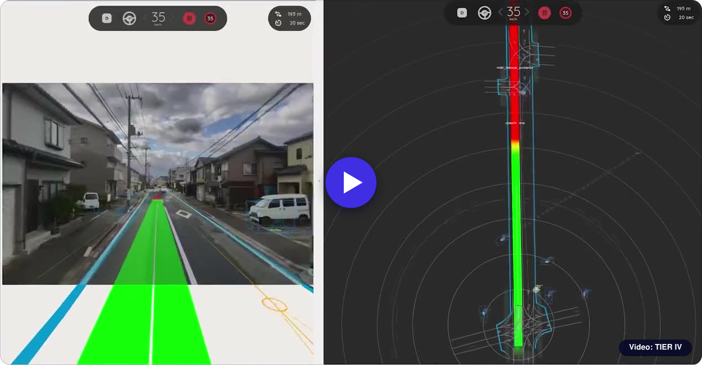

  <a href="https://docs.autoware.org/main/home/">
    <picture>
      <source media="(prefers-color-scheme: dark)" srcset=".github/assets/autoware-horizontal-white.svg" />
      
    </picture>
  </a>

<h3 align="center">Open-source software for autonomous driving</h3>

  

Autoware is the world's leading open-source autonomous driving framework. Autoware provides a comprehensive, production-ready software stack designed to accelerate the commercial deployment of autonomous vehicles across diverse platforms and use cases.

  
  <a href="https://docs.autoware.org/main/simulation/"><picture><source media="(prefers-color-scheme: dark)" srcset=".github/assets/button-run-in-simulation-dark.svg" /></picture></a>

  <a href="https://github.com/autowarefoundation/autoware/releases/tag/2.0.0"><picture><source media="(prefers-color-scheme: dark)" srcset=".github/assets/chip-autoware-2-0-release-notes-dark.svg" /></picture></a>
  <a href="https://docs.autoware.org/main/installation/autoware/autoware-index/"><picture><source media="(prefers-color-scheme: dark)" srcset=".github/assets/chip-autoware-index-dark.svg" /></picture></a>

  
   
  Obstacle avoidance demo by TIER IV. <a href="https://docs.autoware.org/main/home/">Watch the video</a> on the documentation site.

## Get started

<table>
  <tr>
    <td width="50%" valign="top">
      <a href="https://docs.autoware.org/main/installation/"><strong>Install Autoware</strong></a> 
      Set up Autoware from source or with Docker.
    </td>
    <td width="50%" valign="top">
      <a href="https://docs.autoware.org/main/simulation/"><strong>Simulation</strong></a> 
      Run Autoware in a planning, rosbag replay, scenario, or digital twin simulation.
    </td>
  </tr>
</table>

<table>
  <tr>
    <td width="50%" valign="top">
      <a href="https://docs.autoware.org/main/tutorials/"><strong>Tutorials</strong></a> 
      Follow step-by-step guides, from simulation to your own vehicle.
    </td>
    <td width="50%" valign="top">
      <a href="https://docs.autoware.org/main/design/"><strong>Architecture design</strong></a> 
      Learn how Autoware is built: its components and interfaces.
    </td>
  </tr>
</table>

<table>
  <tr>
    <td width="50%" valign="top">
      <a href="https://docs.autoware.org/main/community/support/"><strong>Support</strong></a> 
      Find out where to ask questions, report problems, and talk with the community.
    </td>
    <td width="50%" valign="top">
      <a href="https://docs.autoware.org/main/contributing/"><strong>Contribute</strong></a> 
      Help improve Autoware and its documentation.
    </td>
  </tr>
</table>

## Capabilities

Autoware handles the full autonomous driving stack, from sensing to control.

<table>
  <tr>
    <td width="50%" valign="top">
      <a href="https://docs.autoware.org/main/design/autoware-architecture-v2/"><strong>AI and learning</strong></a> 
      End-to-end (E2E) driving models, ML-based perception, and data-driven trajectory prediction.
    </td>
    <td width="50%" valign="top">
      <a href="https://docs.autoware.org/main/design/autoware-architecture-v1/components/perception/"><strong>Perception</strong></a> 
      Multi-sensor fusion (lidar, camera, radar), traffic light recognition, and dynamic object tracking.
    </td>
  </tr>
</table>

<table>
  <tr>
    <td width="50%" valign="top">
      <a href="https://docs.autoware.org/main/design/autoware-architecture-v1/components/localization/"><strong>Localization</strong></a> 
      NDT matching combined with GNSS/IMU odometry for positioning in mapped environments.
    </td>
    <td width="50%" valign="top">
      <a href="https://docs.autoware.org/main/design/autoware-architecture-v1/components/planning/"><strong>Planning</strong></a> 
      Behavior planning for intersections and lane changes, plus real-time dynamic obstacle avoidance.
    </td>
  </tr>
</table>

<table>
  <tr>
    <td width="50%" valign="top">
      <a href="https://docs.autoware.org/main/design/autoware-architecture-v1/components/control/"><strong>Control</strong></a> 
      Trajectory following and standardized vehicle interfaces for drive-by-wire platforms.
    </td>
    <td width="50%" valign="top">
      <a href="https://docs.autoware.org/main/simulation/"><strong>Simulation</strong></a> 
      Digital twin simulation (AWSIM), rosbag replay, and scenario simulation for validation.
    </td>
  </tr>
</table>

Autoware runs on many vehicle platforms. Its validated use cases are:

  
  
  
  

## Documentation

The [Autoware documentation site](https://docs.autoware.org/main/home/) is the start point for users and developers. Its source is in [autowarefoundation/autoware-documentation](https://github.com/autowarefoundation/autoware-documentation).

Each main repository also has its own documentation:

- [Autoware Core](https://autowarefoundation.github.io/autoware_core/main/): the core packages of Autoware.
- [Autoware Universe](https://autowarefoundation.github.io/autoware_universe/main/): community packages that extend Autoware Core.
- [Autoware Tools](https://autowarefoundation.github.io/autoware_tools/main/): tools to develop and evaluate Autoware.
- [Autoware Index](https://index.autoware.org/): community packages that live in their own repositories.

## Contributing

    
    
    
    

- Read the [contribution guidelines](https://docs.autoware.org/main/contributing/) before you open a pull request.
- See the [working groups](https://github.com/autowarefoundation/autoware-projects/wiki#working-group-list) to learn about the work in progress and how the projects are managed.
- If you have a technical question, start a discussion in the [Q&A category](https://github.com/autowarefoundation/autoware/discussions/categories/q-a). You can also ask there if a problem is a bug.

## Useful resources

<!--- CI Reports -->

    
    

- [Autoware Foundation homepage](https://www.autoware.org/)
- [Vision, mission, and core values](https://docs.autoware.org/main/home/vision-mission-core-values/)
- [Multi-year roadmap](https://docs.autoware.org/main/home/roadmap/multi-year-roadmap/)
- [Media kit](https://docs.autoware.org/main/home/media-kit/): the logos, the colors, and the fonts of Autoware.
- [Support guidelines](https://docs.autoware.org/main/community/support/)
- [CI metrics](https://autowarefoundation.github.io/autoware-ci-metrics/)

 

  

  <a href="https://www.autoware.org/">
    <picture>
      <source media="(prefers-color-scheme: dark)" srcset=".github/assets/autoware-foundation-one-line-white.svg" />
      
    </picture>
  </a>
   
  The Autoware Foundation manages the development of Autoware.

<!--- License and social media -->

  
  
  
  

